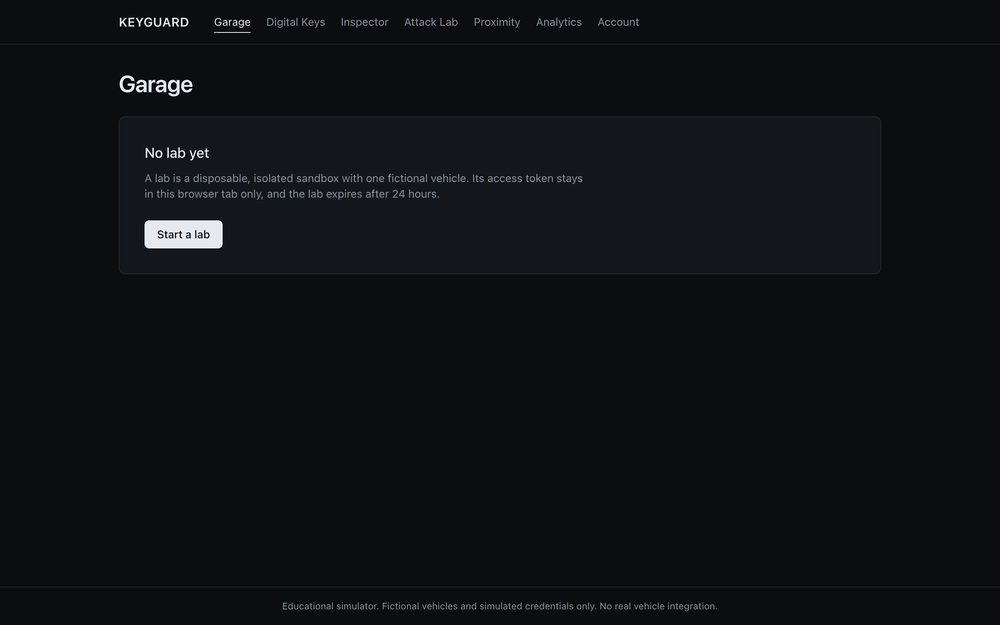
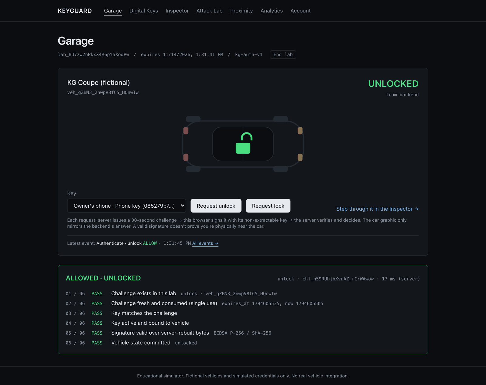
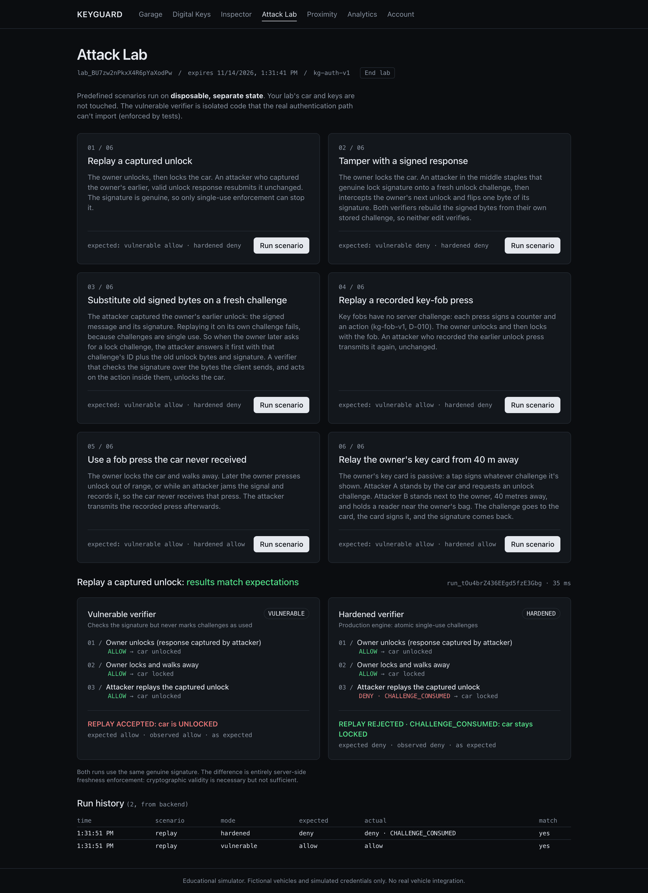

# KeyGuard

[](https://github.com/PranaVVelu/keyguard/actions/workflows/ci.yml)

An educational lab for digital car keys. You enroll a browser-generated key, unlock a fictional car with ECDSA P-256
challenge-response, and then attack it. Each attack runs against an isolated vulnerable verifier and the real engine,
side by side. Fictional vehicles only.

**Live demo: https://keyguard-six.vercel.app** · **[Case study](docs/CASE_STUDY.md)** · [Demo script](docs/DEMO.md)



**What's in it** (the backend makes every decision; the UI only shows them):
- **Garage:** request unlock or lock and see the server's decision with its six checks.
- **Digital Keys:** non-extractable browser keys, enrollment and revocation.
- **Inspector:** a step-by-step view of a real challenge-response exchange, then a replay of it.
- **Attack Lab:** six scenarios (replay, tampering, signed-bytes substitution, fob replay, fob capture, relay), each
  run against both verifiers.
- **Security Analytics:** a searchable event log with failure categories.
- **Credential types:** phone, passive key card, and a rolling-counter key fob.
- **Proximity (conceptual):** a relay demo showing that a valid signature doesn't prove distance.
- **Accounts (optional):** sign in with a passkey (no passwords) to save labs for 30 days.

| Garage | Attack Lab |
|---|---|
|  |  |

**Evidence:**
- 397 API tests pass on SQLite and PostgreSQL, and the spec's 11-row mandatory test matrix passes through the real API
  ([latest evidence](docs/evidence/matrix-latest.md)).
- Playwright drives the whole journey in a real browser, including WCAG A/AA scans with axe.
- All of it runs in CI.
- The live deployment was smoke-tested in production ([results](docs/SECURITY_TESTS.md#live-deployment-smoke-test)).
- The usability sessions haven't been run yet. [docs/RELEASE_GATES.md](docs/RELEASE_GATES.md) shows exactly what is
  and isn't met.

## Quick start

```bash
docker compose up --build      # then open http://localhost:3000
```

Then follow the [demo script](docs/DEMO.md).

To host your own copy for free (no domain needed): [docs/DEPLOY_FREE.md](docs/DEPLOY_FREE.md). One Vercel project runs both apps,
with Neon Postgres added from Vercel's Storage tab.

## Layout

```
apps/web/          Next.js 16 + TypeScript + Tailwind
  lib/             encoding.ts (kg-auth-v1), crypto.ts (Web Crypto), keystore.ts (IndexedDB), auth-flow.ts, api.ts
  tests/           node --test (encoding vectors, Web Crypto interop, helpers, API client)
  e2e/             Playwright (owner journey, tampering, isolation, accessibility)
services/api/      FastAPI backend
  app/security/    protocol.py (kg-auth-v1 + ECDSA verify), challenges.py (atomic consume), authenticate.py (decision engine),
                   labs.py, keys.py, events.py, ratelimit.py, cleanup.py
  app/models/      DB tables, API schemas
  app/routes/      HTTP endpoints
  tests/           pytest suite
docs/              spec, review, threat model, decisions, test evidence, test vectors
```

## Setup without Docker

Requires [uv](https://docs.astral.sh/uv/) (it provides Python 3.12) and Node 24+.

```bash
cd services/api
uv sync --python 3.12
uv run pytest
uv run python -m app.evidence.matrix   # structured security matrix (spec §7)
uv run uvicorn app.main:create_app --factory --reload --port 8000
```

```bash
cd apps/web
npm install
npm test             # unit tests
npm run dev          # http://localhost:3000
npx playwright install chromium && npm run e2e   # real-browser tests (starts its own API and web server)
```

## Implemented API

| Method | Endpoint | Notes |
|--------|----------|-------|
| POST | `/api/labs` | Creates a lab and one fictional vehicle. Returns `lab_token` once. |
| GET | `/api/labs/{id}/vehicles` | Requires `Authorization: Bearer <lab_token>`. Any failure returns `404 LAB_NOT_FOUND`. |
| POST | `/api/labs/{id}/keys` | Enroll a P-256 SPKI public key for a vehicle in this lab |
| GET | `/api/labs/{id}/keys` | List key metadata (fingerprint, status; never the key bytes) |
| POST | `/api/labs/{id}/keys/{keyId}/revoke` | Revoke a credential (immediate; idempotent) |
| POST | `/api/labs/{id}/challenges` | Issue a 30-second single-use challenge for (vehicle, key, action) |
| POST | `/api/labs/{id}/authenticate` | Verify a signed challenge; returns allow/deny with a reason and a 6-step trace |
| POST | `/api/labs/{id}/fob` | Key-fob press (kg-fob-v1 rolling counter, D-010); allow/deny with a 6-step trace |
| GET | `/api/labs/{id}/scenarios` | List Attack Lab scenarios |
| POST | `/api/labs/{id}/scenarios/{scenario}` | Run vulnerable vs hardened on disposable state |
| GET | `/api/labs/{id}/lab-runs` | Scenario run history (expected vs actual per mode) |
| GET | `/api/labs/{id}/events` | Sanitized event history; filter by `category`, `result`, `reason`, `q`; paged |
| GET | `/api/labs/{id}/events/summary` | Pass/fail per category, failure reasons, authentication timing |
| POST | `/api/auth/register/options` · `/verify` | Create an account with a passkey (WebAuthn, D-012) |
| POST | `/api/auth/login/options` · `/verify` | Usernameless passkey sign-in; sets the HttpOnly session cookie |
| POST | `/api/auth/logout` | Revoke the session |
| GET | `/api/account` | Account, passkey info and saved labs |
| POST | `/api/labs/{id}/save` | Save a lab to the account (needs the lab token and a session) |
| POST | `/api/account/labs/{id}/open` · `/unsave` | Reopen a saved lab (fresh token) or stop saving it |
| POST | `/api/account/delete` | Delete the account and its saved labs (`{"confirm": "DELETE"}`) |
| GET | `/api/health` | Liveness check |

Every endpoint is rate limited (`429 RATE_LIMITED` with `Retry-After`; limits are in D-009). Expired labs are deleted by a
background cleanup task (`KEYGUARD_CLEANUP_INTERVAL`, default 300 s).

> Upgrading from an earlier sprint? The event table changed. Delete your local `keyguard.db` (lab data is disposable);
> the API refuses to start on a stale schema and tells you so.

## Docs

- [Case study](docs/CASE_STUDY.md)
- [Product requirements and status](docs/PRD.md)
- [Architecture](docs/ARCHITECTURE.md)
- [Release gates](docs/RELEASE_GATES.md)
- [Deployment](docs/DEPLOYMENT.md)
- [Demo script](docs/DEMO.md)
- [Usability and accessibility](docs/USABILITY.md)
- [Requirements review and sprint plan](docs/REQUIREMENTS_REVIEW.md)
- [Threat model](docs/THREAT_MODEL.md)
- [Decisions](docs/DECISIONS.md)
- [Security test evidence](docs/SECURITY_TESTS.md)
- [Design direction (draft)](docs/DESIGN_DIRECTION.md)
- [Spec (PDF)](docs/KeyGuard_Product_and_Engineering_Specification.pdf)

## Limitations

A valid signature does not prove physical proximity (relay attacks are out of scope). Browser keys are not hardware-backed.
Passing the curated test suite does not prove the system is secure in general.
