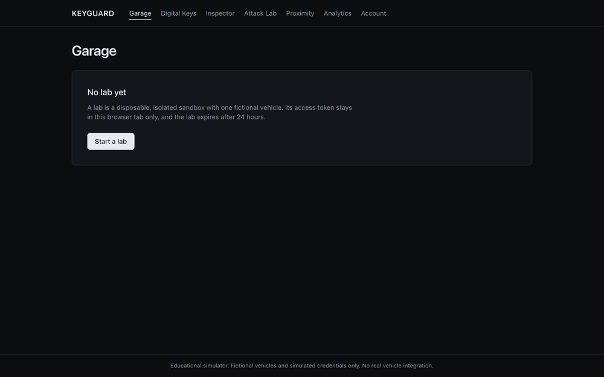
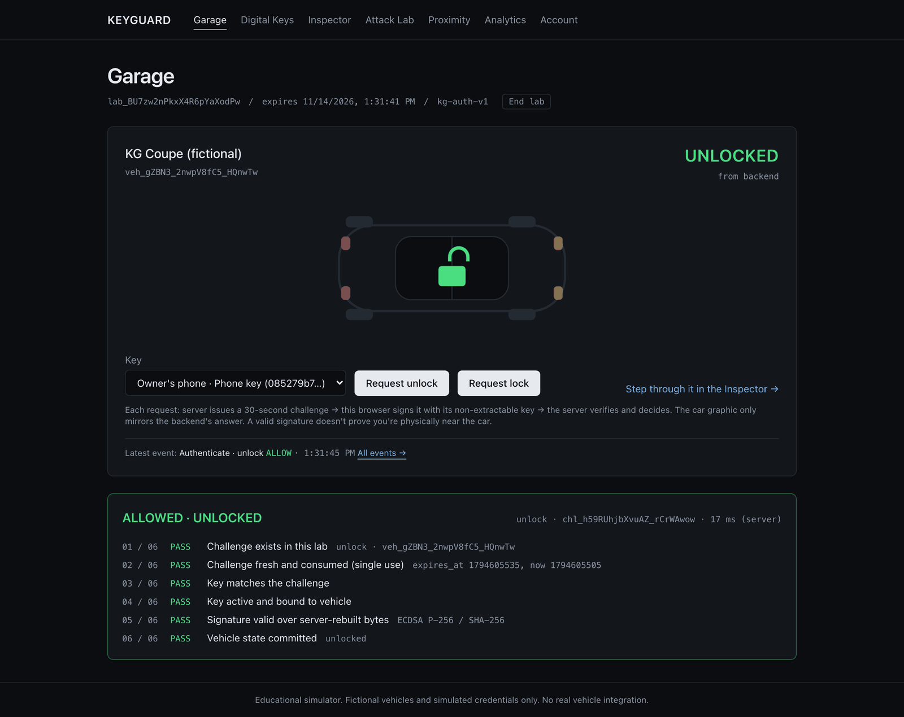
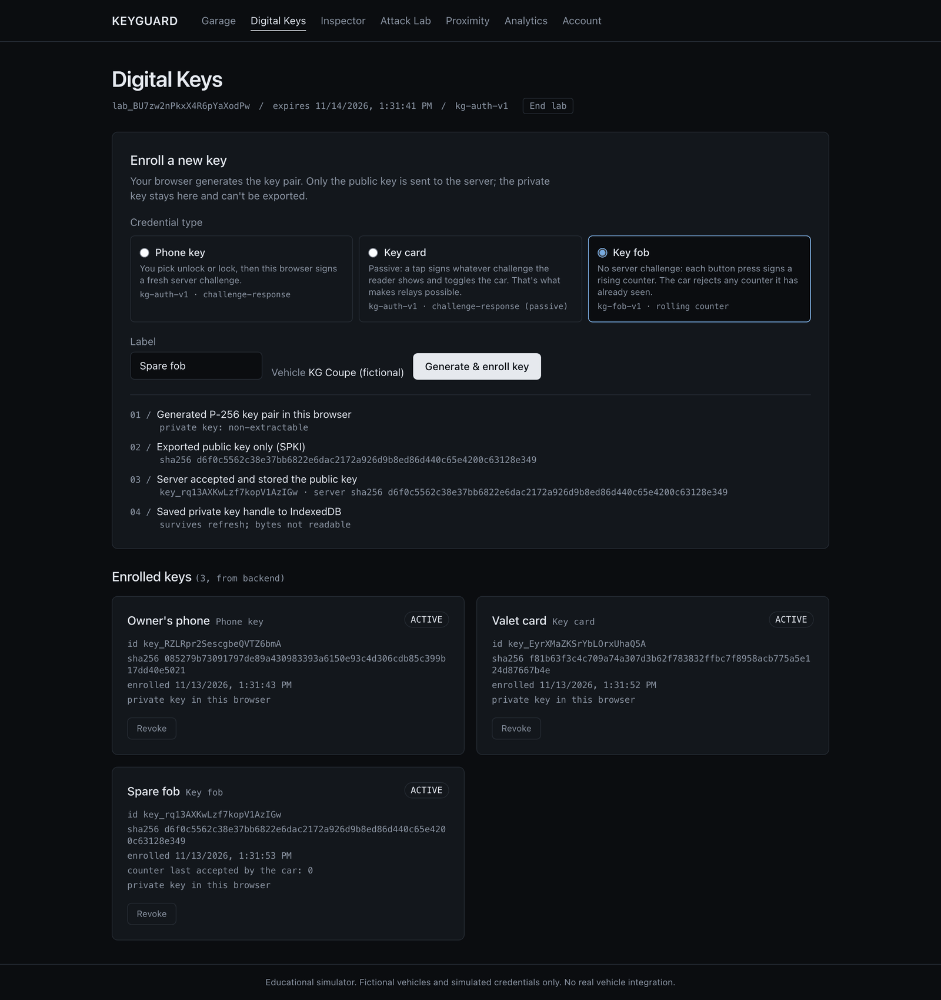
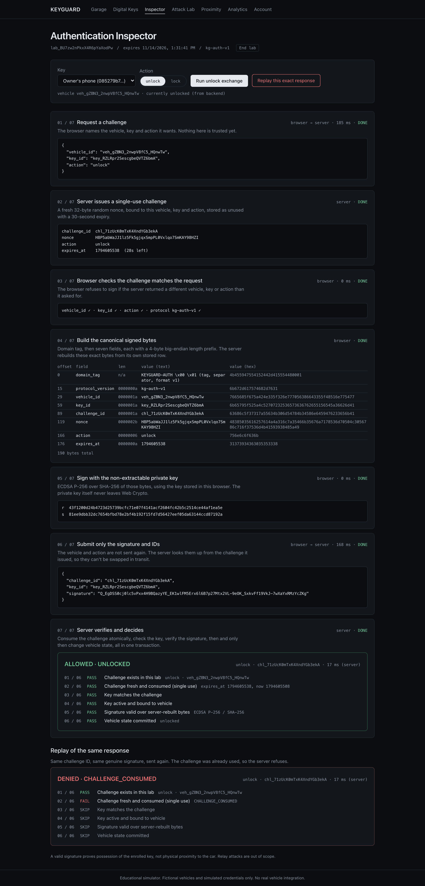
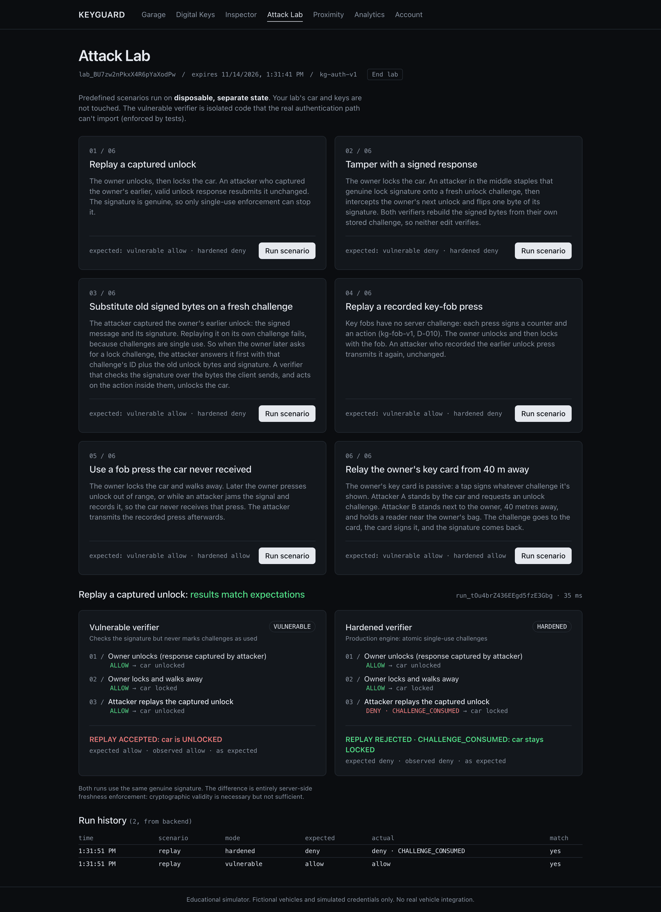
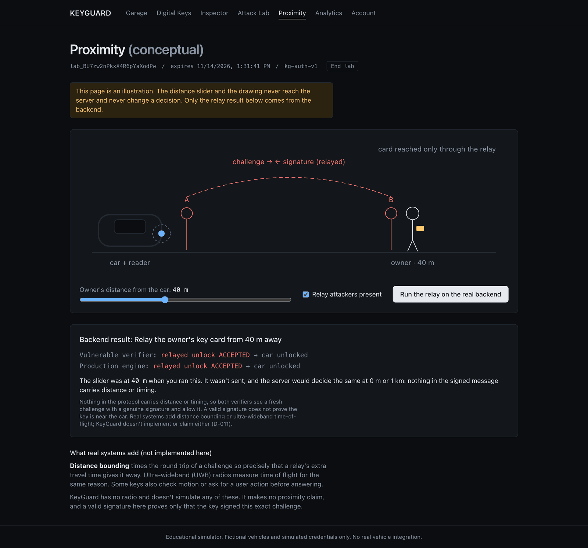
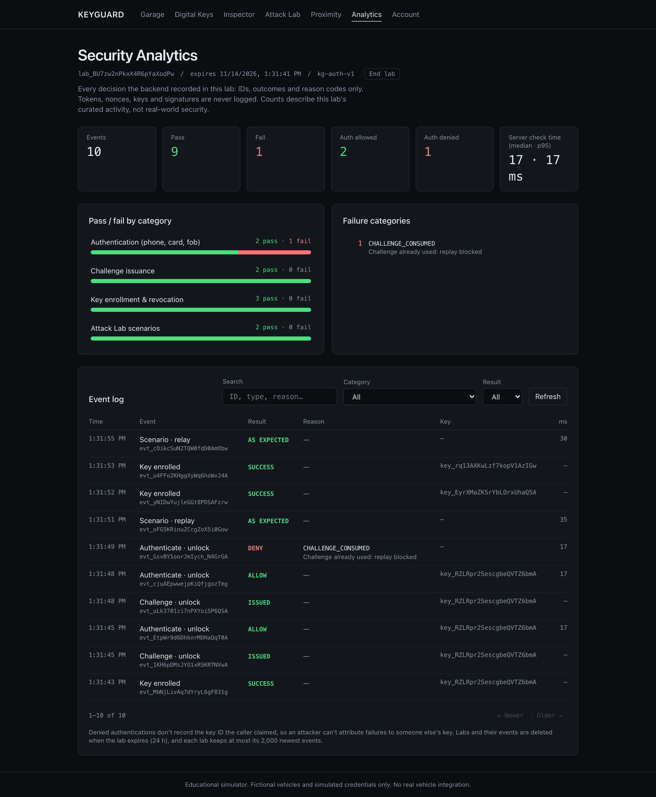

# KeyGuard: case study

**Live demo:** https://keyguard-six.vercel.app · **Code:** this repository · **Fictional vehicles only.**



## The question

Digital car keys (phone keys, NFC cards, key fobs) are challenge-response systems, but most explanations stop at
"the phone signs something". KeyGuard is a lab for one question: **what exactly does a car have to check before it
unlocks, and what goes wrong if it skips one of those checks?**

You use it in the browser. Start a private lab, enroll a key that your browser generates, and unlock a fictional car.
Then attack it: replay a captured unlock, tamper with a signature, swap in old signed bytes, replay a fob press, or
relay a key card. Each attack runs against two verifiers side by side, a deliberately vulnerable one and the real
engine, so you can see which single check makes the difference.

## How an unlock works

```
browser                                   server
  │  POST /challenges {vehicle, key, action}  │
  │ ────────────────────────────────────────▶ │  32-byte nonce, bound to vehicle + key + action, 30 s expiry
  │ ◀──────────────────────────────────────── │
  │  sign(kg-auth-v1 bytes) with a            │
  │  non-extractable P-256 key (Web Crypto)   │
  │  POST /authenticate {challenge_id, sig}   │
  │ ────────────────────────────────────────▶ │  in one transaction:
  │                                           │   1 consume the challenge (conditional UPDATE: unused, unexpired)
  │                                           │   2-4 check the key matches, is active and is bound to the vehicle
  │                                           │   5 verify ECDSA over bytes the server rebuilds itself
  │ ◀──────────────────────────────────────── │   6 only then change the vehicle's state
```

The browser never says "this worked". The UI only displays decisions that came from the API.

## Five things that turned out to matter

**1. Single use has to be atomic.** "Check if used, then mark it used" lets two simultaneous copies of the same
response both succeed. The engine consumes a challenge with one conditional `UPDATE … SET consumed_at = now WHERE
consumed_at IS NULL AND expires_at > now`, which does the check and the write in one step. The evidence is matrix row MX-08: 16 concurrent submissions of one response produce exactly one
allow, on SQLite and PostgreSQL ([matrix](evidence/matrix-latest.md)).

**2. Verify the bytes you built, not the bytes you were sent.** In the *signed-bytes substitution* scenario, an
attacker answers a fresh lock challenge with an old, genuinely signed *unlock* message. A verifier that checks the
signature over client-supplied bytes, and acts on the action inside them, unlocks the car. The engine rebuilds the
canonical `kg-auth-v1` message from its own challenge row (D-001), so the old signature can't verify.

**3. Keep the vulnerable code where production can't reach it.** The vulnerable verifiers live in `app/lab/vulnerable/`
and run only on disposable state. An AST import-graph test fails CI if anything on the real authentication path imports
them (D-005).

**4. Say what the design *doesn't* stop.** Some attacks get through both verifiers, and the lab says so:
- **Fob capture before receipt.** A rolling-counter fob (`kg-fob-v1`, D-010) rejects any counter it has already seen.
  It can't detect a press that was recorded and jammed before the car received it.
- **Relay attacks.** A relay of a passive key card succeeds too, because a valid signature proves possession of the
  key, not distance.

The Proximity page shows this with a slider the server never sees, and explains distance bounding and UWB as what real
systems add (D-011).

**5. Moving to PostgreSQL exposed bugs SQLite had hidden.** Running the whole suite on PostgreSQL found two real bugs:
- 32-bit columns overflowed on fob counters near 2^53 and on timestamps after 2038 (fixed with `BIGINT`);
- the per-lab key limit could be raced to 18 keys against a limit of 10 (fixed with `SELECT … FOR UPDATE`).

Both now have regression tests, and removing either fix makes its test fail on PostgreSQL. CI runs every test on both
databases (D-013).

## Accounts without passwords

Saving labs is optional and uses **passkeys** (WebAuthn: resident key, user verification required). The account
features are:
- single-use, purpose-bound challenges;
- sign-count regression detection (`PASSKEY_CLONED`);
- an HttpOnly `SameSite=Strict` session cookie stored only as a hash;
- a required CSRF header on every write;
- saved labs claimed with an atomic ownership check, so they can't be transferred.

The tests use a small software authenticator (`tests/webauthn_sim.py`), which builds real CBOR/COSE responses and can
produce each specific bad response a test needs (D-012).

## Hosting it for free, safely

The live demo runs as one Vercel project, using Vercel Services for the Next.js site and FastAPI, with Neon Postgres.
There's no custom domain.
- **One origin:** the site and API share an address, so the CSP is `connect-src 'self'` and the session cookie is
  first-party.
- **Rate-limit key can't be spoofed:** the API reads the visitor's IP only from the header Vercel's edge overwrites.
  A production test sent a different fake IP on every request; they were still counted as one visitor and hit the
  limit.
- **Startup check:** with `KEYGUARD_ENV=production`, the API refuses to start with unsafe settings (in-memory rate
  limits, a non-HTTPS origin, SQLite, a missing cron secret and so on).
- **Second hosting mode:** a Render option is also tested. It uses an authenticated server-side proxy, and the whole
  browser test suite runs through it in CI.

Production smoke-test results are in [SECURITY_TESTS.md](SECURITY_TESTS.md#live-deployment-smoke-test).

## Evidence, not claims

Each security property in the docs points to the test that demonstrates it.

| What | Count |
|---|---|
| API tests (pass on SQLite and PostgreSQL) | 397 |
| Spec's mandatory test matrix | 11/11 rows, both databases |
| Web unit tests (encoding vectors, Web Crypto interop, proxy, helpers) | 73 |
| Playwright browser tests (direct / proxy mode), including WCAG A/AA scans with axe | 17 / 20 |
| Threats in the threat model, each with a mitigation or explicit non-claim | 26 |
| Recorded design decisions | 13 |

Important checks were also mutation-tested by hand: break the code on purpose and confirm a test fails. Two examples
are reading `X-Forwarded-For` left to right and removing a row lock. The one change that *wasn't* caught is written up,
with the reason it was still safe ([SECURITY_TESTS.md](SECURITY_TESTS.md)).

## Screenshots

| | |
|---|---|
|  |  |
| **Garage:** the server's decision and its six checks | **Digital Keys:** browser-generated, non-extractable keys |
|  |  |
| **Inspector:** every message, then the same response replayed | **Attack Lab:** six scenarios, two verifiers |
|  |  |
| **Proximity:** what a signature doesn't prove | **Analytics:** every decision, searchable |

## Limitations

- It's a simulator: there's no radio, no real vehicle protocol, and no hardware-backed keys beyond what the browser
  provides.
- The web CSP still allows inline scripts. A nonce-based policy is a planned follow-up.
- Usability sessions with real participants haven't been run yet ([USABILITY.md](USABILITY.md)).

## How it was built

KeyGuard was built from a written product and engineering spec over 11 sprints:
- **Sprints 1–8:** the MVP;
- **Sprints 9–10:** key cards, fobs, proximity and passkey accounts;
- **Sprint 11:** hosting hardening.

Each design choice is recorded in [DECISIONS.md](DECISIONS.md), and each release gate is tracked in
[RELEASE_GATES.md](RELEASE_GATES.md).

**Stack:** FastAPI, Pydantic (strict), SQLAlchemy Core, `cryptography` and `py_webauthn`; Next.js 16, React 19,
Tailwind 4 and Web Crypto; Playwright and axe-core; GitHub Actions; Vercel and Neon.
